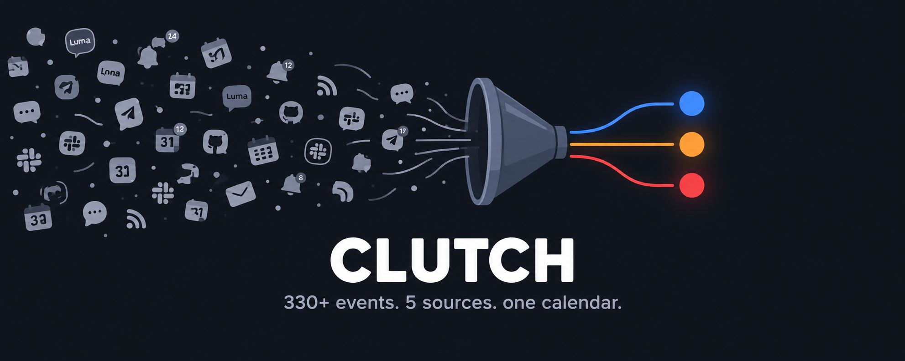

# Clutch

<p align="center">
  
</p>

> The AI that won't let you miss what matters.

Clutch is a local-first AI agent that monitors your communities — Discord, Luma, KonfHub, Hacktoberfest, RSS — scores every event against your interest profile using Gemma 3, and puts what matters on your Google Calendar with escalating color-coded reminders.

## How It Works

```
5 Connectors (330+ events)
  -> Pre-filter (keyword match, drops obvious noise)
  -> Gemma 3 scoring (interest, urgency, scarcity, impact)
  -> Google Calendar (time-based color escalation)
  -> Temporal (durable 4h cycle, survives restarts)
```

Events start blue on your calendar. As deadlines approach, they turn orange, then red. Past events are auto-deleted. You never configure this — time does it.

## Quick Start

```bash
# Prerequisites: Python 3.12+, Ollama with gemma3:4b, Podman (optional)
ollama pull gemma3:4b

# Clone and install
git clone https://github.com/Malay-dev/clutch.git
cd clutch
uv venv && source .venv/bin/activate
uv pip install -e ".[dev]"
uv pip install -e connectors/rss -e connectors/luma -e connectors/konfhub -e connectors/hacktoberfest -e connectors/discord

# Configure your interests
vim clutch.yaml

# Test without any API keys
clutch sandbox full

# Run for real (no calendar)
clutch run --once --no-calendar

# Set up Google Calendar (one-time)
clutch setup google
clutch auth google

# Run with calendar
clutch run --once

# Run with Temporal (start worker, then trigger)
podman compose --profile temporal up -d
clutch run --temporal &
clutch run --temporal-once
```

## Configuration

Edit `clutch.yaml`:

```yaml
profile:
  name: Your Name
  interests:
    - AI/ML
    - open source
    - hackathons
    - your interests here
  location: Your City

connectors:
  rss:
    enabled: true
    feeds:
      - https://dev.to/feed
  luma:
    enabled: true
    cities: [Bengaluru, Remote]
  konfhub:
    enabled: true
    countries: [India]
  hacktoberfest:
    enabled: true
    countries: [IN]

scoring:
  max_calendar_events: 10
  max_new_per_run: 5
```

## CLI

```bash
clutch connectors             # list discovered plugins
clutch run --once             # single pipeline run
clutch run --temporal         # start Temporal worker
clutch run --temporal-once    # one-shot through Temporal
clutch status                 # event counts
clutch radar                  # priority table
clutch done "DevFest"         # mark done, clear calendar
clutch digest                 # morning brief
clutch sandbox full           # test without tokens
clutch setup google           # guided OAuth setup
```

## Building a Connector

Each connector is a standalone Python package. Clone the template:

```bash
cp -r connectors/template connectors/my-source
```

Implement two methods:

```python
class MyConnector(ClutchConnector):
    name = "mysource"
    source_type = "event"

    async def fetch(self) -> list[NormalizedEvent]: ...
    async def health_check(self) -> bool: ...
```

Register via entry point in `pyproject.toml`:

```toml
[project.entry-points."clutch.connectors"]
mysource = "clutch_connector_mysource:MyConnector"
```

Install and Clutch discovers it automatically. See `connectors/template/README.md` for the full guide.

## Architecture

| Layer | Choice |
|-------|--------|
| AI | Ollama + Gemma 3 4B (local) |
| Orchestration | Temporal (6 activities, parallel fetch) |
| Calendar | Google Calendar API (native colors) |
| Database | pgvector (Temporal backend + interest graph) |
| CLI | Python + Typer |
| Containers | Podman (fully OSS) |

## License

MIT
